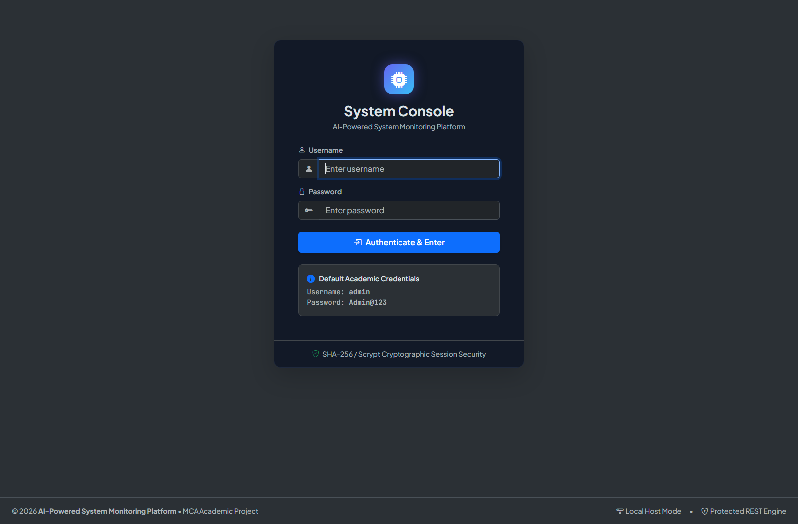
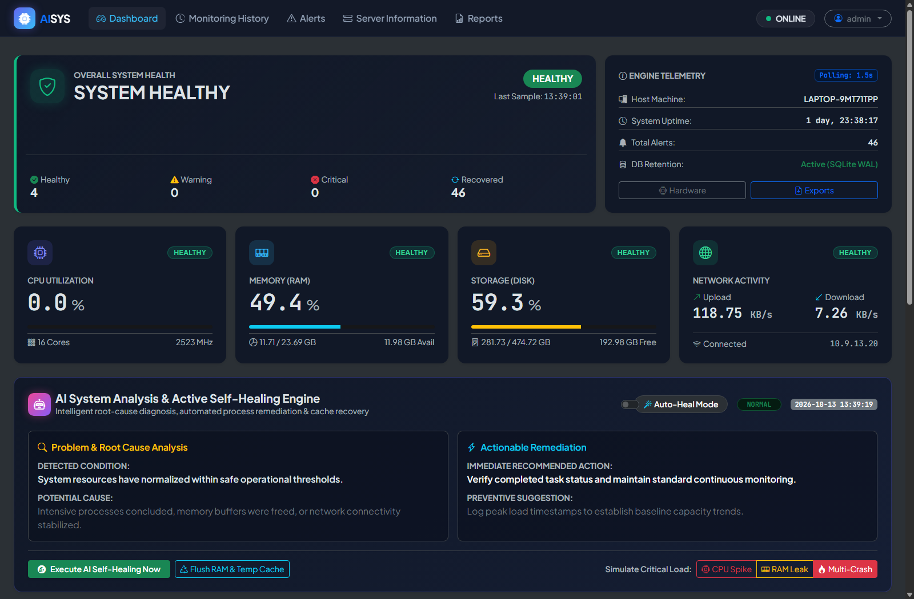
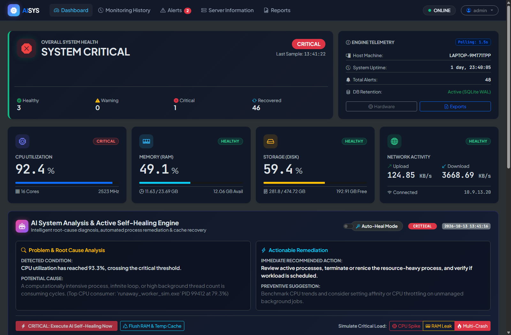
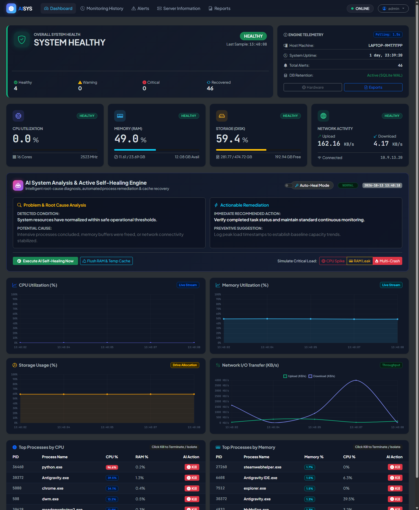
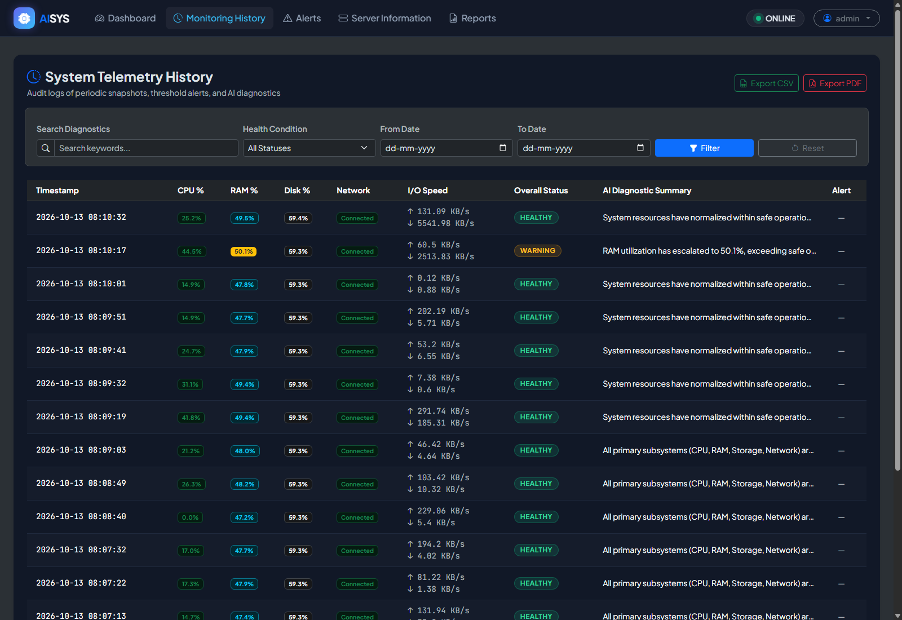
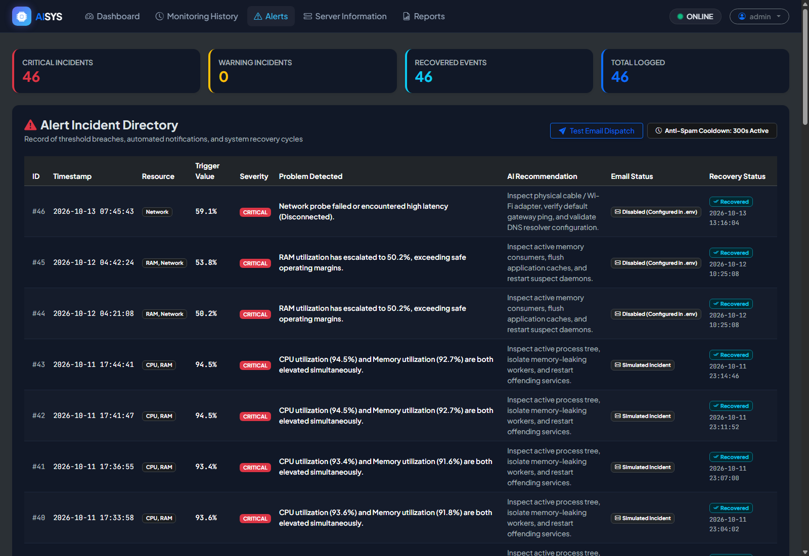
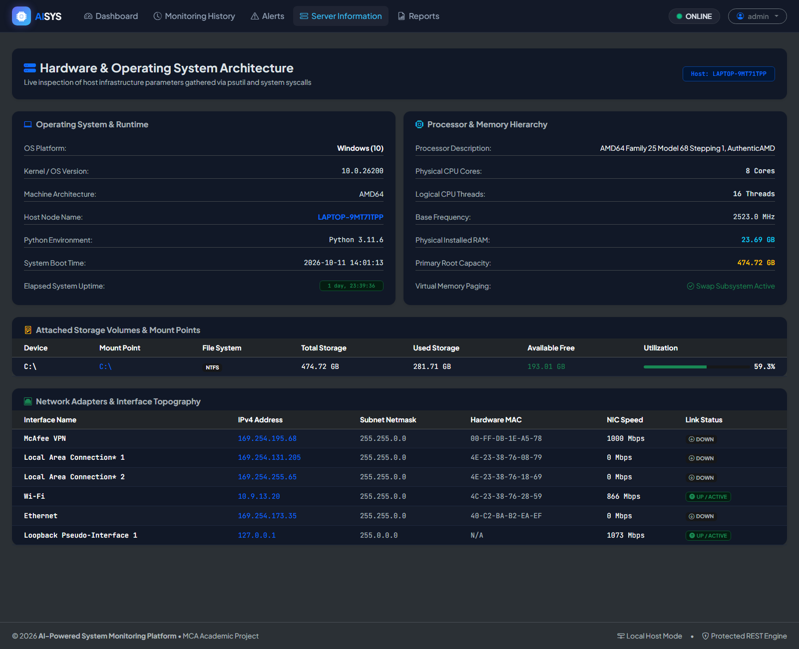
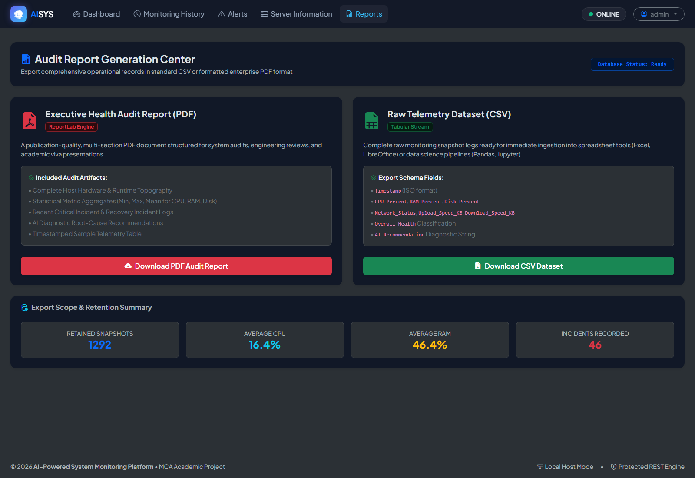

# AI-Powered System Monitoring Platform

A production-grade, web-based intelligent system monitoring platform developed for academic MCA demonstrations and production-like infrastructure management. The system continuously tracks host hardware and network telemetry in real time, classifies overall system health, executes a multi-resource AI recommendation engine for root-cause diagnosis, dispatches rate-limited SMTP alerts with automated recovery detection, visualizes metrics via dynamic Chart.js streams, and provides downloadable CSV and publication-ready ReportLab PDF health audit reports.

---

## 1. Project Overview & Architecture

### High-Level Architecture
```
Host Machine (Windows / Linux / macOS)
                   │
                   ▼
       System Telemetry Engine (psutil)
  [CPU Utilization, RAM, Disks, Network I/O]
                   │
                   ▼
         Health Evaluation Engine
   [Categorizes: HEALTHY / WARNING / CRITICAL]
                   │
       ┌───────────┴───────────┐
       ▼                       ▼
AI Recommendation Engine   Alert & Cooldown Manager
[Multi-Resource Analysis]  [Anti-Spam SMTP Dispatch]
       │                       │
       └───────────┬───────────┘
                   ▼
      Thread-Safe Database (SQLite WAL)
[Snapshots, Incidents, Recoveries, Diagnostics]
                   │
                   ▼
           Flask REST API Engine
  [/api/metrics, /api/health, /api/history, ...]
                   │
                   ▼
     Responsive Web Console (Bootstrap 5)
  [Live Metric Cards, Chart.js Streams, AI Box]
```

### Component Breakdown
1. **`monitoring/system_monitor.py`**: Interacts with the host kernel via `psutil` to retrieve instantaneous CPU core utilization, clock frequencies, virtual RAM buffers, and disk mount partitions.
2. **`monitoring/network_monitor.py`**: Computes real-time bandwidth delta (`KB/s` and `MB/s`), performs socket-level reachability verification, and extracts network adapter configurations.
3. **`monitoring/health_checker.py`**: Implements centralized classification against configurable thresholds to derive individual resource states and overall system health.
4. **`ai/recommendation_engine.py`**: Multi-dimensional diagnostic engine evaluating single-metric and cross-resource correlations (e.g., simultaneous CPU + RAM spikes, memory exhaustion with swap paging) with root-cause identification and remediation steps.
5. **`alerts/email_alert.py`**: SMTP mailer with anti-spam cooldown gating and automated recovery notifications.
6. **`reports/`**: In-memory generators producing raw CSV telemetry datasets (`csv_report.py`) and multi-page styled audit reports (`pdf_report.py` using ReportLab).
7. **`database.py`**: Manages SQLite connections in WAL mode with connection pooling, indexes, and seeded administrator accounts.

---

## 2. Directory Structure

```
AI-System-Monitor/
├── app.py                     # Main Flask application, routes, and background worker
├── config.py                  # Central configuration and threshold management
├── database.py                # Database schemas, migrations, and CRUD helpers
├── requirements.txt           # Python dependency manifest
├── .env                       # Environment variables (credentials, thresholds)
├── .gitignore                 # Repository ignore rules
├── README.md                  # Project documentation & viva guide
│
├── monitoring/
│   ├── __init__.py
│   ├── system_monitor.py      # Hardware metrics (CPU, RAM, Disk, Procs)
│   ├── network_monitor.py     # Bandwidth delta, socket probe, NIC info
│   └── health_checker.py      # Metric & overall health classification
│
├── ai/
│   ├── __init__.py
│   └── recommendation_engine.py # Rule-based & multi-resource root-cause analyzer
│
├── alerts/
│   ├── __init__.py
│   └── email_alert.py         # SMTP email dispatcher with cooldown & recovery
│
├── reports/
│   ├── __init__.py
│   ├── csv_report.py          # CSV exporter
│   └── pdf_report.py          # ReportLab PDF generator
│
├── templates/
│   ├── base.html              # Base layout with navbar & styling
│   ├── login.html             # Authentication portal
│   ├── dashboard.html         # Real-time dashboard with Chart.js
│   ├── history.html           # Historical logs with filtering & pagination
│   ├── alerts.html            # Incident directory & recovery tracking
│   ├── server_info.html       # Hardware, OS, and NIC specifications
│   └── reports.html           # Report generation and download center
│
├── static/
│   ├── css/
│   │   └── style.css          # Modern dark cyber theme & animations
│   └── js/
│       ├── dashboard.js       # Real-time polling & DOM updates
│       ├── charts.js          # Chart.js live stream buffers
│       └── monitoring.js      # Global helper utilities
│
├── data/
│   └── monitoring.db          # Persistent SQLite database
│
└── tests/
    ├── __init__.py
    ├── test_monitoring.py     # Tests for psutil metrics
    ├── test_health.py         # Tests for thresholds & AI recommendations
    └── test_api.py            # Tests for authentication, APIs, and exports
```

---

## 3. Technology Stack

- **Backend**: Python 3.11, Flask 3.0.3, `psutil` 7.2.2, `python-dotenv`, `Werkzeug`
- **Frontend**: HTML5, CSS3 (Custom Dark Cyber Theme), Bootstrap 5.3.3, Bootstrap Icons 1.11.3, Chart.js 4.4.3
- **Database**: SQLite with Write-Ahead Logging (WAL) enabled (easily migrated to PostgreSQL)
- **Reporting**: ReportLab 5.0.1 (PDF generation) and Python CSV library
- **Testing**: Python `unittest` framework

## 4. Application Screenshots & Visual Tour

### 4.1 Secure Authentication Portal (`/login`)

*Session-based credential verification with SHA-256 and Scrypt cryptographic hashing.*

### 4.2 Real-Time Observability Command Center (`/dashboard`)

*Live hardware telemetry gauges, overall system health banner, and active AI self-healing controls.*

### 4.3 AI Anomaly Detection & Critical Root-Cause Diagnosis

*Autonomous detection of CPU spikes, root-cause attribution to offending PID (`runaway_worker_sim.exe`), and immediate remediation recommendation.*

### 4.4 Rolling Chart Streams & Targeted Process Isolation

*Dynamic Chart.js buffers and top processes tables with one-click **Kill** process termination buttons.*

### 4.5 Historical Telemetry Logs (`/history`)

*Historical audit table with keyword search, condition filtering, date ranges, and pagination.*

### 4.6 Incident Alert Directory & Recovery Tracking (`/alerts`)

*Incident lifecycle log with severity categorization, anti-spam cooldown, and recovery tracking.*

### 4.7 Server & Operating System Architecture (`/server-info`)

*Host hardware topography, processor hierarchy, mounted storage volumes, and network adapters.*

### 4.8 Executive Audit Reports Center (`/reports`)

*One-click export center for publication-ready ReportLab PDF health reports and raw CSV telemetry datasets.*

---

## 5. Installation & Setup Instructions

### Prerequisites
- Python 3.9+ installed on your operating system.

### Step 1: Clone or Navigate to Project Directory
```powershell
cd C:\Users\abine\.gemini\antigravity\scratch\AI-System-Monitor
```

### Step 2: Install Dependencies
```powershell
python -m pip install -r requirements.txt
```

### Step 3: Configure Environment Variables
Review or edit `.env` in the project root:
```ini
SECRET_KEY=production-ai-monitor-secure-key-2026-xyz
FLASK_ENV=production
HOST=127.0.0.1
PORT=5000

# Monitoring Intervals (in seconds)
REALTIME_UPDATE_INTERVAL=1.5
PERSISTENCE_INTERVAL=5.0
ALERT_COOLDOWN_SECONDS=300

# Thresholds (%)
CPU_WARNING_THRESHOLD=50.0
CPU_CRITICAL_THRESHOLD=80.0
RAM_WARNING_THRESHOLD=50.0
RAM_CRITICAL_THRESHOLD=80.0
DISK_WARNING_THRESHOLD=70.0
DISK_CRITICAL_THRESHOLD=85.0

# Email Alerts (Optional SMTP)
EMAIL_ENABLED=False
EMAIL_HOST=smtp.gmail.com
EMAIL_PORT=587
EMAIL_USE_TLS=True
EMAIL_USERNAME=your_email@gmail.com
EMAIL_PASSWORD=your_app_password
ALERT_RECIPIENT=admin@company.com
```

### Step 4: Run the Application
```powershell
python app.py
```
Open your browser and navigate to:
**`http://127.0.0.1:5000`**

### Step 5: Log In
- **Default Username**: `admin`
- **Default Password**: `Admin@123`

---

## 5. REST API Documentation

All API endpoints are protected and return standardized JSON responses:

| Method | Endpoint | Description |
|---|---|---|
| `GET` | `/api/metrics` | Instantaneous CPU, RAM, Disk, Network I/O, health, top processes, and AI recommendation |
| `GET` | `/api/health` | Status breakdown for CPU, RAM, Disk, Network, and Overall Health |
| `GET` | `/api/history` | Historical monitoring snapshots (`?limit=50`) |
| `GET` | `/api/alerts` | Logged alert incidents and recovery status (`?limit=50`) |
| `GET` | `/api/recommendations` | Latest AI recommendation and remediation instructions |
| `GET` | `/api/server-info` | Hardware specs, CPU cores, RAM, Disk, OS version, and uptime |
| `GET` | `/api/network` | Detailed network interface addresses and transfer rates |
| `GET` | `/api/summary` | Aggregate counts (healthy, warning, critical, total alerts, recoveries) |
| `POST` | `/api/remediate/execute` | Triggers AI Self-Healing, cache clean, or targeted process termination |
| `POST` | `/api/remediate/simulate` | Triggers or clears controlled critical load simulations (`cpu`, `ram`, `multi`) |
| `POST` | `/api/remediate/toggle-auto` | Toggles autonomous background AI self-healing daemon mode |

---

## 7. Testing & Quality Verification

Run the comprehensive automated test suite (29 tests):
```powershell
python -m unittest discover -s tests -v
```

### Test Coverage Highlights:
- **`test_monitoring.py`**: Verifies hardware metrics, core count, frequency, RAM buffers, disk partitions, top processes, and network socket probing.
- **`test_health.py`**: Verifies threshold boundaries (0-49% Healthy, 50-80% Warning, >80% Critical), multi-resource correlation (CPU + RAM spike), and automated recovery detection.
- **`test_api.py`**: Verifies session-based authentication, unauthorized redirects, dashboard rendering, all REST APIs, and binary exports of CSV and PDF files.

---

## 8. Viva Voce & Academic Demonstration Guide (20 Questions & Answers)

### Q1: What is the primary objective of this project?
**Answer**: To build an intelligent, web-based system monitoring platform that continuously monitors server health metrics (CPU, RAM, Disk, Network) in real time, classifies operational states (HEALTHY, WARNING, CRITICAL), and employs an AI recommendation engine to provide contextual root-cause explanations and remediation advice.

### Q2: Why did you use `psutil` instead of executing shell commands like `top` or `tasklist`?
**Answer**: `psutil` (Python system and process utilities) directly interfaces with OS-level C syscalls, kernel structures, and `/proc` APIs without spawning external shell sub-processes. This makes it cross-platform (Windows, Linux, macOS), highly performant, thread-safe, and free from shell injection risks.

### Q3: How is real-time visualization achieved without overwhelming the browser or database?
**Answer**: We decoupled UI polling from database persistence:
1. **Frontend Polling**: The dashboard uses the Fetch API to query `/api/metrics` every 1.5 seconds, updating rolling Chart.js buffers (capped at 15 points) in memory.
2. **Database Persistence**: A background daemon thread captures snapshots and persists them to SQLite every 5 seconds. This prevents hundreds of redundant records from being written every minute.

### Q4: Explain how your AI Recommendation Engine works.
**Answer**: It uses a rule-based expert diagnostic system with multi-resource correlation. Instead of treating each metric in isolation, it correlates multi-dimensional spikes (e.g., simultaneous CPU and RAM spikes indicate worker leaks or run-away batch jobs; high CPU with high disk I/O indicates swap thrashing or heavy database indexing). It outputs a structured diagnosis: Problem, Severity, Possible Cause, Recommended Action, and Preventive Action.

### Q5: How does the AI recommendation engine avoid alert fatigue?
**Answer**: It tracks system state transitions in memory. A new diagnostic is only generated and logged when the condition changes, crosses a threshold, or recovers. If the system stays in a steady state, redundant duplicate logs are not generated.

### Q6: How does the Alert Cooldown mechanism work?
**Answer**: In `alerts/email_alert.py`, an alert cooldown timer (default: 300 seconds) is enforced. When a critical threshold is breached, an alert email is sent and a timestamp is recorded. Subsequent critical samples within the cooldown window are marked as "Suppressed (Cooldown active)", preventing mailbox flooding.

### Q7: Explain the concept of Automated Recovery Detection.
**Answer**: When a system that was previously in a `CRITICAL` or `WARNING` state returns to `HEALTHY`, the engine detects this positive state transition. It marks previous unrecovered alerts in the database with `is_recovered = 1` and a `recovery_timestamp`, emits a "SYSTEM RECOVERED" event, and optionally sends a recovery confirmation email.

### Q8: How is the Overall System Health calculated?
**Answer**: It follows a centralized priority matrix in `monitoring/health_checker.py`:
- If any vital resource (CPU, RAM, Disk, Network) is `CRITICAL`, overall health becomes **`CRITICAL`**.
- If no resource is critical but one or more are `WARNING`, overall health becomes **`WARNING`**.
- Only when all resources are within normal thresholds does the system evaluate to **`HEALTHY`**.

### Q9: Why did you choose SQLite, and how can the platform scale to PostgreSQL?
**Answer**: SQLite requires zero configuration and operates with zero setup friction for local evaluation. By enabling WAL (Write-Ahead Logging) mode, SQLite achieves high concurrency. Because our database layer uses standard ANSI SQL types, primary/foreign keys, and standard indexes, migrating to PostgreSQL only requires changing the connection string to `psycopg2` or SQLAlchemy.

### Q10: How are user passwords secured?
**Answer**: Passwords are never stored in plain text. They are hashed using modern cryptographic hashing (`scrypt` via `werkzeug.security.generate_password_hash`) with unique salts. Verification is handled using constant-time hash comparison (`check_password_hash`) to prevent timing attacks.

### Q11: How does the Network Monitor measure upload and download speeds?
**Answer**: It tracks cumulative bytes sent and received via `psutil.net_io_counters()`. On each tick, it calculates the delta in bytes divided by elapsed time in seconds:
$$\text{Speed (KB/s)} = \frac{\Delta \text{Bytes}}{1024 \times \Delta t}$$

### Q12: How does the network monitor verify internet connectivity?
**Answer**: It attempts a non-blocking TCP socket connection to a reliable DNS server (Google DNS `8.8.8.8:53` with fallback to Cloudflare DNS `1.1.1.1:53`) with a 1.5-second timeout. If the socket handshake succeeds, connectivity is confirmed; otherwise, it reports latency or offline status.

### Q13: What library is used to generate PDF reports and why?
**Answer**: `ReportLab`. It builds pure vector PDF files programmatically using flowable tables, paragraphs, and custom typography without depending on external headless browsers like Chromium/WebKit, ensuring lightweight and reliable execution.

### Q14: What information is included in the PDF Health Audit Report?
**Answer**:
1. Host server specs (OS, kernel, CPU cores, RAM, Disk, Uptime, Python runtime).
2. Statistical aggregates (Min, Max, Mean for CPU, RAM, and Disk).
3. Recent critical alerts with severity and AI recommendations.
4. Historical snapshot table with timestamps and health classifications.

### Q15: How does the dashboard update live without full page refreshes?
**Answer**: Using client-side JavaScript (`dashboard.js`) and the native asynchronous `fetch()` API. It repeatedly calls `/api/metrics`, receives a JSON payload, and modifies specific DOM nodes (progress bars, text counters, status pills) and Chart.js dataset arrays directly.

### Q16: How do you handle concurrency between Flask web requests and the background monitor?
**Answer**: A daemon thread is launched upon application startup. Because SQLite connections cannot be shared across threads, each database helper in `database.py` obtains its own connection via `get_db_connection()` and closes it when done. SQLite WAL mode allows concurrent readers while a writer commits.

### Q17: What security protections are implemented against unauthorized access?
**Answer**:
- `@login_required` route decorator checks session state.
- Unauthenticated requests are redirected to `/login`.
- Session cookies are protected with `HttpOnly` and `SameSite=Lax`.
- All user inputs in SQL queries are parameterized to prevent SQL Injection.

### Q18: What happens if an external SMTP server is down or unconfigured?
**Answer**: The system isolates the failure gracefully. The `AlertManager` logs the incident locally, flags the email status as `Disabled` or `Failed: <reason>`, and continues monitoring without crashing the web application.

### Q19: How does the platform handle pagination and filtering in the history view?
**Answer**: In `history.html` and `database.get_filtered_history()`, SQL `WHERE` clauses dynamically filter by status, date range, and text search, while `LIMIT` and `OFFSET` implement efficient database-side pagination without loading thousands of rows into memory.

### Q20: What are potential future enhancements for this platform?
**Answer**:
1. **Container & Kubernetes Integration**: Deploying sidecar containers to monitor Docker / Kubernetes pod metrics.
2. **Generative LLM Integration**: Connecting local LLMs (via Ollama) or Gemini API for natural-language diagnostic conversational interfaces.
3. **Multi-Node Agent Architecture**: Deploying lightweight metric collectors across a distributed server cluster reporting to a centralized master controller.

---

## 9. License & Academic Attribution
Developed as an academic project demonstration for MCA (Master of Computer Applications).
Author: Engineering Team &copy; 2026.
